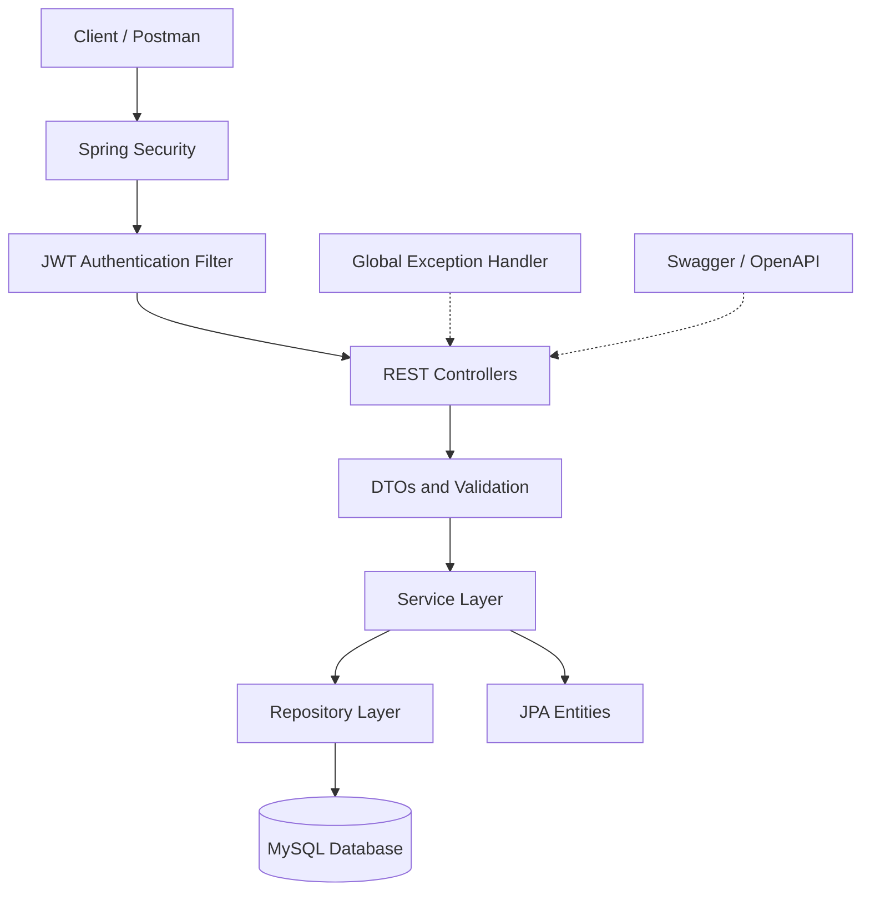
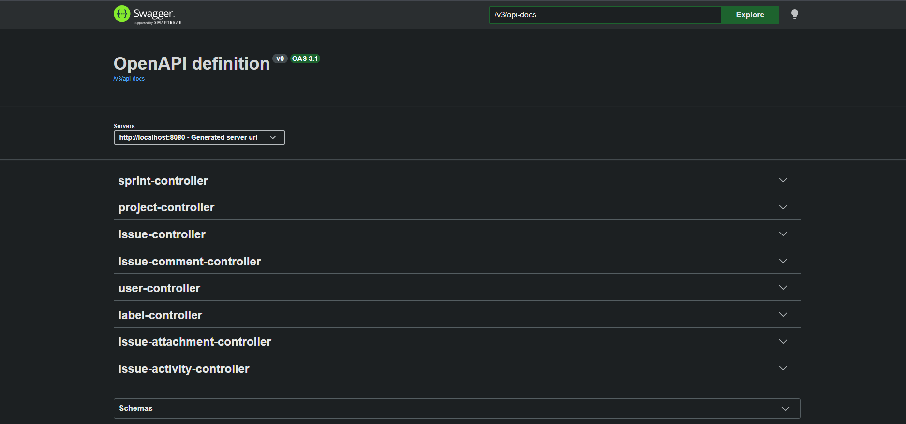

# DevFlow – Project & Issue Management REST API

DevFlow is a backend REST API application built using Java and Spring Boot to manage projects, issues, team collaboration, and sprint workflows.

It provides secure APIs for managing project tasks, tracking issue progress, assigning team members, and monitoring project activities.

## Features

### Authentication & Authorization
- User registration and login
- JWT-based authentication
- Role-based access control (Admin, Manager, Developer)
- Password encryption using BCrypt

### Project Management
- Create, view, update, and delete projects
- Manage project-related issues
- Prevent deletion of projects with linked issues

### Issue Management
- Create, update, view, and delete issues
- Manage issue status and priority
- Filter issues by status, priority, assignee, and labels
- Search issues by title
- Pagination and sorting
- Track overdue issues

### Team Collaboration
- Add and manage issue comments
- Ownership-based comment authorization
- Upload, download, and delete attachments
- Create and assign labels to issues

### Kanban Board
- Organize issues by workflow status
- Update issue status
- Track issue status changes

### Sprint Management
- Create and manage sprints
- Assign issues to sprints
- Start and complete sprints
- Track sprint progress

### Dashboard & Activity Tracking
- Project and issue summary
- Priority and assignee statistics
- Sprint progress overview
- Track issue activities with pagination

## Technology Stack

| Technology | Purpose |
|---|---|
| Java | Programming language |
| Spring Boot | Backend framework |
| Spring Security | Authentication and authorization |
| Spring Data JPA | Database operations |
| Hibernate | ORM |
| MySQL | Relational database |
| JWT | Token-based authentication |
| Maven | Build and dependency management |
| Swagger / OpenAPI | API documentation |
| Postman | API testing |

## Project Architecture

The application follows a layered architecture to maintain separation of concerns, improve code organization, and make the application easier to maintain.

### Architecture Layers

- **Controller:** Handles incoming HTTP requests and returns API responses.
- **Service:** Contains business logic and processes application operations.
- **Repository:** Handles database operations using Spring Data JPA.
- **Entity:** Represents database tables and their relationships.
- **DTO:** Transfers data between API layers and separates request/response structures from entities.
- **Security:** Handles JWT-based authentication, authorization, and role-based access control.
- **Exception:** Provides centralized exception handling and consistent error responses.

### Architecture Diagram

### Request Flow

1. The client sends an HTTP request with a JWT token.
2. Spring Security validates the authentication and authorization.
3. The REST Controller receives the request.
4. DTOs and validation handle incoming request data where applicable.
5. The Service Layer executes the business logic.
6. The Repository Layer communicates with the MySQL database.
7. The response is returned to the client.

Global exception handling manages application errors, while Swagger/OpenAPI provides interactive API documentation.

## Database Configuration

1. Create a MySQL database:

   `CREATE DATABASE devflow_db;`

2. Configure the following environment variables before running the application:

   - `DB_PASSWORD` – MySQL database password
   - `JWT_SECRET` – Secret key used for JWT signing

The application reads these values through environment variables rather than storing credentials directly in the source code.

## Running the Application

1. Clone the repository:

   `git clone https://github.com/amisha-15/devflow-backend.git`

2. Open the project in Eclipse or another Java IDE.

3. Configure the required environment variables: `DB_PASSWORD` and `JWT_SECRET`.

4. Make sure MySQL is running and the `devflow_db` database exists.

5. Run `DevflowBackendApplication.java` as a Java application.

The application starts on:

`http://localhost:8080`

## API Documentation

Swagger UI:

`http://localhost:8080/swagger-ui/index.html`

Open Swagger UI to explore and test the available REST API endpoints.

## API Endpoints

Base URL: `http://localhost:8080`

### 1. Project Management

| Method | Endpoint | Description |
|---|---|---|
| GET | `/api/projects` | Get all projects |
| POST | `/api/projects` | Create a new project |
| GET | `/api/projects/{id}` | Get project by ID |
| PUT | `/api/projects/{id}` | Update a project |
| DELETE | `/api/projects/{id}` | Delete a project |

### 2. Issue Management

| Method | Endpoint | Description |
|---|---|---|
| GET | `/api/issues` | Get all issues with sorting |
| POST | `/api/issues` | Create a new issue |
| GET | `/api/issues/{id}` | Get issue by ID |
| PUT | `/api/issues/{id}` | Update an issue |
| DELETE | `/api/issues/{id}` | Delete an issue |
| GET | `/api/issues/status/{status}` | Get issues by status |
| GET | `/api/issues/priority/{priority}` | Get issues by priority |
| GET | `/api/issues/filter?status=OPEN&priority=HIGH` | Filter issues by status and priority |
| GET | `/api/issues/assignee/{assigneeId}` | Get issues by assignee |
| GET | `/api/issues/label/{labelId}` | Get issues by label |
| GET | `/api/issues/search?title=login` | Search issues by title |
| GET | `/api/issues/due-date?startDate=2026-11-01&endDate=2026-11-30` | Get issues by due-date range |
| GET | `/api/issues/overdue` | Get overdue issues |
| GET | `/api/issues/paginated?page=0&size=5` | Get paginated issues |
| GET | `/api/issues/page?page=0&size=5&sortBy=createdAt&direction=desc` | Get issues with pagination and sorting |
| PATCH | `/api/issues/{issueId}/status` | Update issue status |

### 3. Comments Management

| Method | Endpoint | Description |
|---|---|---|
| GET | `/api/issues/{issueId}/comments` | Get comments for an issue |
| POST | `/api/issues/{issueId}/comments` | Add a comment to an issue |
| PUT | `/api/issues/{issueId}/comments/{commentId}` | Update a comment |
| DELETE | `/api/issues/{issueId}/comments/{commentId}` | Delete a comment |

### 4. Attachments Management

| Method | Endpoint | Description |
|---|---|---|
| GET | `/api/issues/{issueId}/attachments` | Get attachments for an issue |
| POST | `/api/issues/{issueId}/attachments` | Upload an attachment to an issue |
| GET | `/api/issues/{issueId}/attachments/{attachmentId}/download` | Download an attachment |
| DELETE | `/api/issues/{issueId}/attachments/{attachmentId}` | Delete an attachment |

### 5. Labels Management

| Method | Endpoint | Description |
|---|---|---|
| GET | `/api/labels` | Get all labels |
| POST | `/api/labels` | Create a new label |
| PUT | `/api/issues/{issueId}/labels` | Assign labels to an issue |
| DELETE | `/api/issues/{issueId}/labels/{labelId}` | Remove a label from an issue |

### 6. Dashboard APIs

| Method | Endpoint | Description |
|---|---|---|
| GET | `/api/issues/dashboard/summary` | Get dashboard summary |
| GET | `/api/issues/dashboard/priority-summary` | Get issue priority summary |
| GET | `/api/issues/dashboard/assignee-summary` | Get issue assignee summary |
| GET | `/api/issues/dashboard/overview` | Get complete dashboard overview |

### 7. Activity APIs

| Method | Endpoint | Description |
|---|---|---|
| GET | `/api/issues/{issueId}/activities?page=0&size=5` | Get paginated activities for an issue |

### 8. Sprint Management

| Method | Endpoint | Description |
|---|---|---|
| GET | `/api/sprints` | Get all sprints |
| POST | `/api/sprints` | Create a new sprint |
| GET | `/api/sprints/{id}` | Get sprint by ID |
| PUT | `/api/sprints/{id}` | Update a sprint |
| DELETE | `/api/sprints/{id}` | Delete a sprint |
| PUT | `/api/sprints/{sprintId}/issues` | Assign issues to a sprint |
| GET | `/api/sprints/{sprintId}/issues` | Get issues assigned to a sprint |
| PUT | `/api/sprints/{sprintId}/start` | Start a sprint |
| PUT | `/api/sprints/{sprintId}/complete` | Complete a sprint |
| GET | `/api/sprints/{sprintId}/progress` | Get sprint progress |
| GET | `/api/sprints/{sprintId}/dashboard` | Get sprint dashboard |

### 9. Kanban Board

| Method | Endpoint | Description |
|---|---|---|
| GET | `/api/issues/projects/{projectId}/kanban` | Get Kanban board data for a project |
## API Testing

The APIs were tested using Postman, covering authentication, project management, issue management, comments, attachments, labels, sprints, dashboard, and activity tracking.

## Repository

GitHub: https://github.com/amisha-15/devflow-backend

---

**DevFlow – A Project and Issue Management REST API built with Java and Spring Boot.**

## Screenshots

### Swagger UI

### Postman Collection

The complete Postman collection is available here:

[DevFlow API Testing Collection](postman/DevFlow-API-Testing.json)

Import this JSON file into Postman to test the DevFlow REST APIs.
